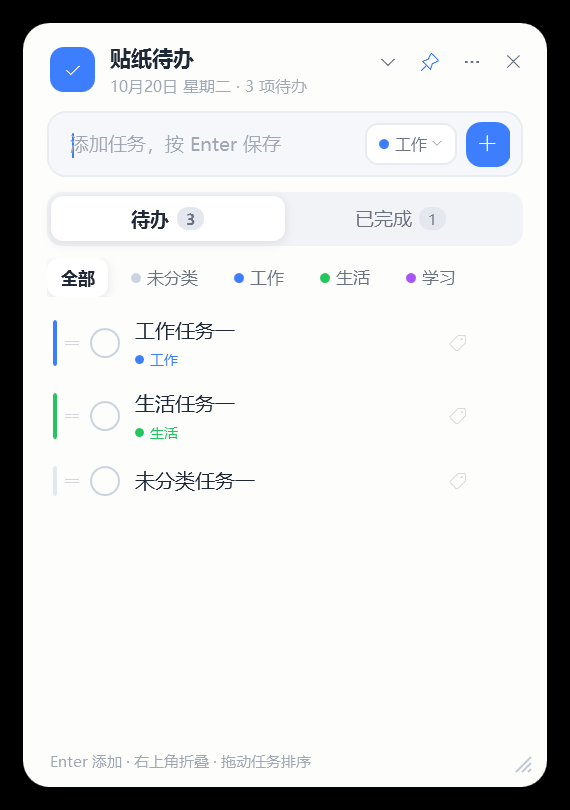
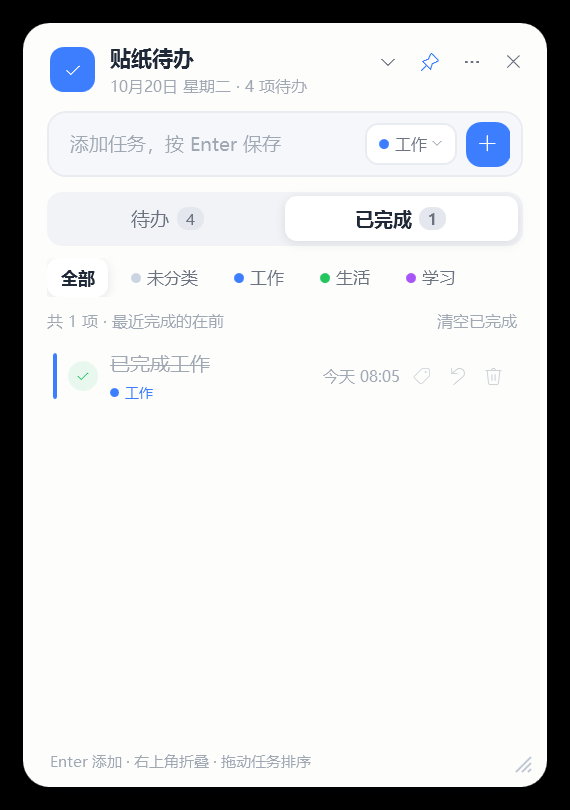

# 贴纸待办（StickerTodo）

> 一款轻量的 Windows 桌面贴纸待办清单：像贴纸一样待在桌面上，不置顶、不挡路；支持分类与拖拽排序，Win+D 显示桌面后依然可见可点，随手记下要做的事。

版本 **v1.1.0** · Windows 10 / 11 · WPF（.NET 10）· 纯本地数据 · 单文件约 0.35 MB

> 项目主页：https://github.com/cccfeiyyy/sticker-todo





## 功能特性

- **桌面贴纸**：无边框圆角卡片，默认「贴到桌面」——窗口不置顶、不进入任务栏 / Alt+Tab；桌面可见时它就待在桌面上，可正常点击和输入。
- **不挡路**：其他普通窗口会盖住它；点击别的窗口后，贴纸会自动回到这些窗口下方（这正是“贴在桌面上”的效果）。按 `Win+D` 显示桌面时它仍然可见。
- **待办管理**：`Enter` 快速添加；点任务左侧圆框完成并进入「已完成」页；已完成任务可恢复为待办、永久删除、一键清空（带确认提示）。
- **分类管理**：内置「工作 / 生活 / 学习」分类，支持新建自定义分类、重命名、删除；顶部胶囊可快速筛选，添加任务时可选分类，已有任务也能随时改分类（行内标签按钮）。
- **拖拽排序**：按住待办任务行拖动即可调整顺序，顺序自动保存；新任务默认排在最前。
- **轻巧交互**：右上角 `⌄` 按钮一键折叠成一条小贴纸；`Esc` 清空输入；窗口淡入动画；已完成任务显示相对完成时间（如「刚刚」「3 分钟前」）。
- **托盘常驻**：托盘图标左键显示窗口；右键菜单支持显示 / 隐藏、贴到桌面、开机自启、清空已完成、打开数据文件夹、退出。
- **开机自启**：可选开机自动启动（当前用户注册表 Run 项），自启启动时不抢焦点、不打扰。
- **单实例**：按数据目录单实例，重复启动会唤醒已有窗口；不同 `--data-dir` 可同时运行多套清单。
- **本地数据 + 自愈**：数据保存在本机 `%APPDATA%\StickerTodo\data.json`，每次修改同步原子落盘；自动保留 `.bak` 备份，主文件损坏时先隔离再尝试用备份恢复。不联网、无遥测。
- **环境自愈**：Explorer 重启后自动恢复托盘与贴纸状态；分辨率/显示器变化时自动把窗口移回屏幕内。
- **轻量**：框架依赖单文件发布仅约 0.35 MB，运行时占用低。

## 快速开始

### 方式一：直接运行发布产物

1. 获取发布文件 `dist\StickerTodo.exe`（从仓库构建或由他人分享）。
2. 双击运行。首次启动时贴纸窗口出现在**屏幕右上区域**（工作区右侧留 48px、顶部留 96px，按 DPI 缩放）；之后会记住上次的位置、大小、折叠状态和页签。
3. 在底部输入框输入任务，按 `Enter`（或点击「＋」按钮）添加；输入框左侧的分类按钮可给新任务选分类（默认「未分类」，也可新建分类）。
4. 点任务左侧圆框完成任务，任务进入「已完成」页；已完成页可恢复、删除、清空。
5. 顶部「全部 / 未分类 / 各分类」胶囊可筛选列表；按住待办任务行拖动可调整顺序。

> **运行时要求**：默认发布的是「框架依赖单文件」，需要先安装 [.NET 10 桌面运行时（Desktop Runtime）](https://dotnet.microsoft.com/download/dotnet/10.0)。
> 不想安装运行时？构建 **自包含单文件** 版本（见「从源码构建」），约 150 MB，双击即用。

### 方式二：从源码构建

前置条件：[.NET 10 SDK](https://dotnet.microsoft.com/download/dotnet/10.0)。

```powershell
# 在仓库根目录运行（自动关闭旧进程、按需生成图标、发布到 dist\）
powershell -NoProfile -ExecutionPolicy Bypass -File .\build.ps1

# 自包含单文件（目标机无需安装 .NET，体积约 150 MB）
.\build.ps1 -SelfContained
```

构建成功后产物位于 `dist\StickerTodo.exe`，脚本会输出文件大小与版本信息。脚本可重复运行（幂等），构建前会结束正在运行的贴纸待办进程。

## 界面与操作

| 位置 / 操作 | 说明 |
| --- | --- |
| 标题栏右侧「⌄」按钮 | 折叠成一条小贴纸 / 展开 |
| 标题栏右侧「图钉」按钮 | 贴到桌面 / 取消贴到桌面（`--no-pin` 启动时点击会提示不可用） |
| 标题栏右侧「⋯」按钮 | 更多菜单：折叠成小贴纸、贴到桌面、开机自启、打开数据文件夹、关于贴纸待办、退出 |
| 标题栏右侧「×」按钮 | 隐藏到托盘（程序继续在托盘运行，不是退出） |
| 按住标题栏拖动 | 移动窗口位置（自动记忆；单击不会折叠） |
| 顶部分类胶囊 | 全部 / 未分类 / 各分类筛选；右键分类胶囊可重命名 / 删除 |
| 输入框左侧分类按钮 | 选择新任务的分类，或「新建分类…」 |
| 任务行右侧标签按钮 | 修改该任务的分类（未分类任务显示灰色标签） |
| 拖动待办任务行 | 调整待办顺序（自动保存；已完成页按完成时间排列） |
| 拖拽右下角 | 调整窗口大小（自动记忆） |
| 底部输入框 | `Enter` 添加任务；`Esc` 清空输入 |
| 任务行左侧圆框 | 勾选完成，任务进入「已完成」页 |
| 待办行右侧删除按钮 | 删除该任务（鼠标悬停行时显示） |
| 已完成行右侧按钮 | 恢复为待办 / 永久删除 |
| 已完成页右上「清空已完成」 | 清空全部已完成任务（弹出确认框） |

折叠后的样子：


## 贴桌面行为说明

- **默认开启「贴到桌面」**：窗口不置顶、不进入任务栏 / Alt+Tab；桌面可见时它就待在桌面上，可以直接点击、输入。
- 其他普通窗口会盖住它；点击别的窗口后，贴纸停留在这些窗口下方——这是「不挡路」的预期行为，不是程序缺陷。
- 按 `Win+D` 显示桌面时，贴纸仍然可见、可点击（内部定时守护会维持这一状态）。
- **取消贴桌面**：点击标题栏图钉按钮，或在「⋯」菜单 / 托盘右键菜单中取消「贴到桌面」。取消后窗口会浮到普通窗口最前，可正常输入；再次开启即恢复贴纸模式。
- 想临时把贴纸叫到前面：点击托盘图标左键（显示并激活窗口），或图钉按钮取消后再开启贴桌面。
- 资源管理器（Explorer）重启、分辨率或显示器变化后，程序会自动恢复托盘与贴纸状态。
- 以 `--no-pin` 启动时不进入贴桌面模式，用于自动化测试 / 录屏 / 多显示器调试。

### 实现说明与限制

为同时满足「不置顶、桌面可见、可交互」三个要求，v1.1.0 采用**普通无边框工具窗口 + 桌面可见性守护**的方案：窗口不置顶，桌面可见时显示在桌面之上，其他普通窗口会正常盖住它；由内部定时守护维持桌面可见状态，因此 Win+D 显示桌面时窗口仍然可见可点。没有使用 WorkerW 子窗口嵌入——在部分 Win11 24H2 + 第三方壁纸软件（如 Wallpaper Engine）环境下，真桌面层嵌入会导致窗口无法点击和输入。
因此在不同桌面环境、全屏应用或系统大版本更新后，贴纸的层级表现可能存在差异；遇到遮挡或点不到时，点击托盘图标把窗口叫到前台，或改用「取消贴到桌面」模式即可。

## 开机自启

- 在「⋯」更多菜单或托盘右键菜单中勾选 **开机自启** 即可开启 / 关闭。
- 开启后会在当前用户注册表写入启动项：
  `HKEY_CURRENT_USER\Software\Microsoft\Windows\CurrentVersion\Run` 下的 `StickerTodo`，命令形如
  `"C:\path\to\StickerTodo.exe" --autostart`；无需管理员权限。
- 自启启动时程序静默贴回桌面，不抢焦点、不打扰。
- 手工关闭方法：软件菜单中取消勾选；或在「任务管理器 → 启动应用」中禁用；或删除上述注册表值。

## 数据位置与备份

| 内容 | 路径 |
| --- | --- |
| 主数据文件 | `%APPDATA%\StickerTodo\data.json` |
| 自动备份 | `%APPDATA%\StickerTodo\data.json.bak` |
| 损坏隔离文件 | `%APPDATA%\StickerTodo\data.json.bad-yyyyMMddHHmmss` |
| 异常日志 | `%APPDATA%\StickerTodo\error.log`（超过 512 KB 自动轮转为 `error.log.old`） |

- 数据为 UTF-8 JSON（顶层 `version` / `items` / `categories` / `settings`），可直接阅读与备份。
- `items` 中每条任务含 `sortOrder`（手动排序序号，越小越靠前）与 `categoryId`（分类 Id，可为 null 表示未分类）；`settings` 中保存分类筛选（`categoryFilter`）与新任务默认分类（`newTaskCategoryId`）。
- 旧版 `data.json`（没有 `categories` 字段）会在首次加载时自动补上「工作 / 生活 / 学习」预置分类，不会丢失原有任务。
- **备份**：退出程序后复制 `data.json`（或整个 `StickerTodo` 目录）到安全位置即可。
- **恢复**：退出程序，把备份文件放回上述路径并重命名为 `data.json`，重新启动。
- **损坏自愈**：主文件损坏时，程序先把它重命名为 `data.json.bad-<时间戳>` 保留现场，再尝试从 `data.json.bak` 恢复；没有可用备份时才从空清单开始，不会崩溃。

## 命令行参数（调试用）

普通用户无需使用；自动化测试、多套清单或问题排查时可用。

| 参数 | 说明 |
| --- | --- |
| `--data-dir <目录>` / `--data-dir=<目录>` | 指定数据目录（默认 `%APPDATA%\StickerTodo`）；不同数据目录可同时运行多个实例 |
| `--no-pin` | 不进入贴桌面模式，以普通窗口启动（自动化测试 / 录屏 / 多显示器调试） |
| `--autostart` | 开机自启标记（由自启项自动传入，自启启动时不抢焦点） |

示例：

```powershell
.\dist\StickerTodo.exe --data-dir "D:\我的数据\贴纸待办"
.\dist\StickerTodo.exe --no-pin
```

## 构建

```powershell
# 框架依赖单文件（默认，轻量，需要 .NET 10 桌面运行时）
.\build.ps1

# 自包含单文件（目标机免安装运行时，约 150 MB）
.\build.ps1 -SelfContained

# 其他开关
.\build.ps1 -SkipIcon      # 跳过图标检查/生成
.\build.ps1 -NoClean       # 构建前不清理 dist 目录
.\build.ps1 -DryRun        # 只检查环境并打印将执行的命令，不实际构建
```

构建脚本兼容 Windows PowerShell 5.1 与 PowerShell 7+。若 `src\TodoSticker\Assets\app.ico` 缺失或损坏，会自动调用 `tools\make-icon.py`（需要带 Pillow 的 Python）重新生成多尺寸图标。

## 测试

```powershell
# 单元测试：TaskStore（增删改查 / JSON 持久化 / 损坏恢复 / 设置）+ AutoStart
dotnet run -c Release --project tests/TodoSticker.Tests

# 端到端测试（需先 build.ps1 生成 dist\StickerTodo.exe）
powershell -NoProfile -ExecutionPolicy Bypass -File .\tools\e2e-test.ps1
```

- **单元测试**：无第三方 NuGet 依赖，中文 PASS/FAIL 输出，失败时进程退出码非 0。覆盖任务增删改查、JSON 持久化、损坏恢复、分类增删改、拖拽排序持久化、筛选设置与开机自启（用临时值名并清理）；数据测试全部使用临时目录。
- **端到端测试**：自动使用临时数据目录（不触碰真实数据），通过 UI Automation 按 `AutomationId` 操作真实窗口，验证启动、窗口属性（不置顶 / 工具窗口 / 跟随 settings 的物理像素位置）、中文任务输入、完成 / 恢复 / 删除、`data.json` 落盘，并保存窗口截图与日志到 `tools\artifacts\`。测试开始前会结束当前运行的贴纸待办进程以保证单实例隔离。
- 图标质量自检：`python tools\make-icon.py --check-only`（校验 9 个尺寸、ICO 头、每帧内容）。

## 常见问题（FAQ）

**Q：怎么给任务分类 / 新建分类？**
A：顶部胶囊下方可以筛选分类；输入框左侧的分类按钮用于选择新任务的分类，选择「新建分类…」可自定义分类名。已有任务点行右侧的标签按钮即可修改分类；右键顶部分类胶囊可以重命名或删除分类（删除后该分类下的任务会变成未分类）。

**Q：怎么调整任务顺序？**
A：按住待办任务行拖动即可调整顺序，松开后自动保存；新任务默认排在最前面。已完成页按完成时间排列，不支持手动排序。

**Q：Win+D 显示桌面后贴纸还在吗？**
A：在。窗口不置顶，但会保持在桌面之上，显示桌面时仍然可见可点。

**Q：贴纸被其他窗口挡住了？**
A：这是预期行为：贴纸位于普通窗口下方，不挡路。点击托盘图标左键可把窗口叫到前台；或取消「贴到桌面」让它变成普通窗口。

**Q：双击程序没反应 / 打不开第二个窗口？**
A：同一数据目录只允许一个实例，第二次启动只会唤醒已有窗口。请在桌面或托盘（点击托盘图标）中找到已运行的窗口。

**Q：点击「×」后贴纸不见了？**
A：那是隐藏到托盘，程序仍在运行。左键点击托盘图标（或托盘菜单「显示贴纸」）即可恢复。真正退出请使用「⋯」菜单或托盘菜单中的「退出」。

**Q：任务突然不见了？**
A：先检查是否在「已完成」页签；再确认是否点了「清空已完成」；最后检查 `%APPDATA%\StickerTodo\data.json` 是否被手动删除或改名。若主文件损坏，程序会生成 `data.json.bad-<时间戳>` 并优先从 `data.json.bak` 恢复。

**Q：资源管理器重启后贴纸不见了？**
A：程序会尝试自动恢复托盘与贴纸状态；若未恢复，重启一次程序即可。

**Q：如何关闭开机自启？**
A：在软件「⋯」菜单或托盘菜单取消勾选；也可在任务管理器启动项中禁用，或删除 `HKCU\Software\Microsoft\Windows\CurrentVersion\Run\StickerTodo`。

**Q：托盘图标找不到？**
A：Windows 11 默认折叠托盘图标，点击任务栏右下角 `^` 展开，或在「任务栏设置 → 其他系统托盘图标」中把「贴纸待办」设为常显。

**Q：提示缺少 .NET 运行时？**
A：安装 .NET 10 桌面运行时，或改用 `.\build.ps1 -SelfContained` 构建自包含版本。

**Q：数据能否多台电脑同步？**
A：不联网、不同步。可手动复制 `data.json` 备份文件到另一台电脑的 `%APPDATA%\StickerTodo\` 下（先退出程序）。

## 卸载

1. 在「⋯」菜单或托盘右键菜单中选择「退出」，确认程序已结束（任务管理器无 `StickerTodo.exe`）。
2. 删除程序文件（`StickerTodo.exe` 或整个程序目录）。
3. 如不再需要数据，删除 `%APPDATA%\StickerTodo` 目录（**删除前建议先备份 data.json**）。
4. 若开启过开机自启，删除注册表值 `HKCU\Software\Microsoft\Windows\CurrentVersion\Run\StickerTodo`（或先在软件内关闭自启再卸载）。

## 更新日志

### v1.1.0
- 新增**任务分类**：内置「工作 / 生活 / 学习」，支持新建自定义分类、重命名、删除；顶部分类胶囊筛选；添加任务时可选分类，已有任务可随时改分类。
- 新增**拖拽排序**：按住待办任务行拖动即可调整顺序，自动保存；新任务默认排最前。
- 优化**折叠交互**：标题栏只负责拖动，折叠改为右上角 `⌄` 按钮，避免单击/拖动时误触折叠。
- 数据格式升级：新增 `categories`、`sortOrder`、`categoryId`、`categoryFilter`、`newTaskCategoryId`；旧版数据自动兼容升级。

## 项目结构

```
build.ps1                     一键构建发布脚本（支持 -SelfContained / -DryRun 等）
src/TodoSticker/              WPF 应用源码（net10.0-windows）
src/TodoSticker/Assets/       应用图标 app.ico（由 tools/make-icon.py 生成）
tools/make-icon.py            多尺寸 ICO 图标生成与自检脚本
tools/e2e-test.ps1            端到端自动化测试（UIAutomation + 截图 + data.json 断言）
tests/TodoSticker.Tests/      无第三方依赖的控制台单元测试
```
